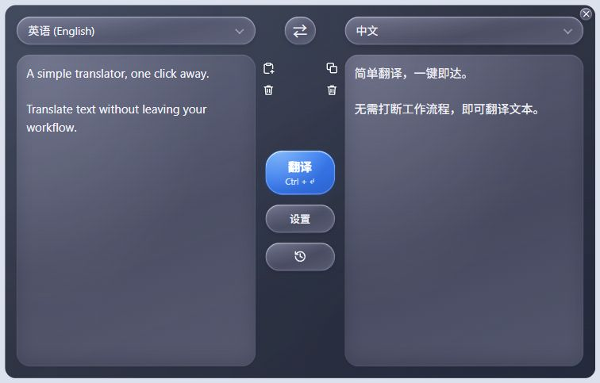

# SimpleT

English | [简体中文](README.zh-CN.md)

A lightweight desktop tray translator for OpenAI-compatible model services.

## Usage



1. Configure the model URL, API key, and model in **Settings**, then save. Use **Refresh** beside the URL to reload available models.
2. Choose the source and target languages, enter text, and click **Translate**. Shortcut: `Ctrl + Enter` on Windows or `⌘ + Enter` on macOS.
3. Open history to view previous translations. Use the small arrows to expand or collapse long entries.

Click the tray or menu bar icon to show or hide the window, or × to hide it. Appearance and interface language are available in Settings.

## Installation

Download the file for your platform from [Releases](https://github.com/ether-zhang/SimpleT/releases/latest):

| Platform | Installation |
| --- | --- |
| Windows x64 | Run the `.exe` directly; no installation needed. Requires the WebView2 runtime. |
| macOS Apple Silicon | Open the `.dmg` and drag `SimpleT.app` into Applications. |

## macOS Signing

macOS builds use an ad hoc signature and are not notarized by Apple. If macOS blocks the app, confirm the download source and choose **Open Anyway** in **System Settings → Privacy & Security**. If it is still blocked, run:

```bash
xattr -dr com.apple.quarantine /Applications/SimpleT.app
```

## Building

Install Node.js, Rust, and the platform build tools: MSVC C++ on Windows or Xcode Command Line Tools on macOS. Install project dependencies first:

```bash
npm ci
```

**Windows (standalone EXE)**

```bash
npm run tauri -- build --no-bundle
```

Output: `src-tauri/target/release/simplet.exe`.

**macOS (DMG)**

```bash
npm run native:package
```

Output directory: `native-macos/target/package/`.
