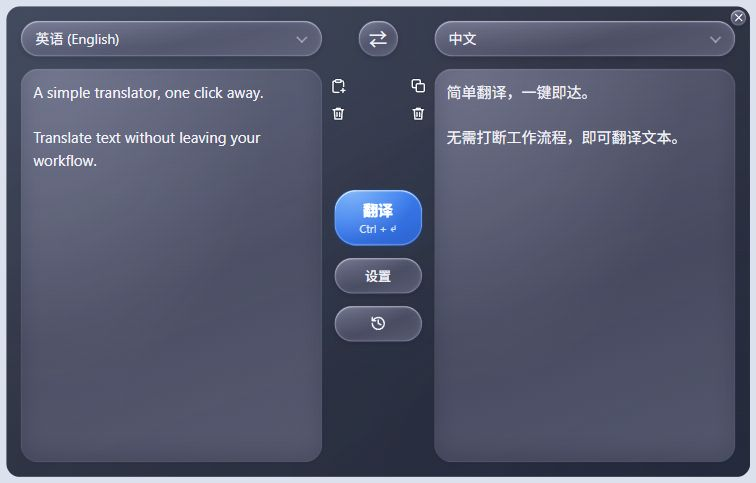

# SimpleT

[English](README.md) | 简体中文

轻量级桌面托盘翻译工具，支持兼容 OpenAI 的模型服务。

## 使用方式



1. 在“设置”中配置模型 URL、API Key 和模型，保存后使用。URL 右侧的“刷新”可重新获取模型列表。
2. 选择源语言和目标语言，输入文本后点击“翻译”。快捷键：Windows `Ctrl + Enter`，macOS `⌘ + Enter`。
3. 点击历史图标查看记录，长文本可通过小箭头展开／收起。

点击托盘／菜单栏图标开关窗口，点击 × 收起；外观和界面语言可在设置中调整。

## 安装方式

从 [Releases](https://github.com/ether-zhang/SimpleT/releases/latest) 下载对应平台的文件：

| 平台 | 安装 |
| --- | --- |
| Windows x64 | 下载 `.exe` 后直接运行，无需安装；需要 WebView2 运行时。 |
| macOS Apple Silicon | 打开 `.dmg`，将 `SimpleT.app` 拖入“应用程序”。 |

## macOS 签名

macOS 包使用临时签名，未经过 Apple 公证。确认下载来源后，若系统拦截应用，可在“系统设置 → 隐私与安全”中选择“仍要打开”。若仍无法启动，运行：

```bash
xattr -dr com.apple.quarantine /Applications/SimpleT.app
```

## 编译方式

需要 Node.js、Rust 和平台构建工具：Windows 使用 MSVC C++ 工具链，macOS 使用 Xcode Command Line Tools。先安装项目依赖：

```bash
npm ci
```

**Windows（免安装 EXE）**

```bash
npm run tauri -- build --no-bundle
```

输出：`src-tauri/target/release/simplet.exe`。

**macOS（DMG）**

```bash
npm run native:package
```

输出目录：`native-macos/target/package/`。
